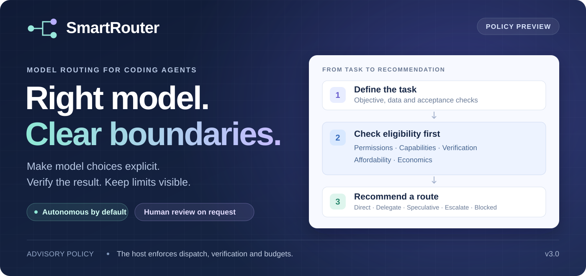

[](#how-it-works)

# SmartRouter

[](https://github.com/StepenkoAnatoli/SmartRouter/actions/workflows/regression-gate.yml)
[](LICENSE)
[](https://github.com/StepenkoAnatoli/SmartRouter/commits/main/)
[](https://github.com/StepenkoAnatoli/SmartRouter/stargazers)
[](https://github.com/StepenkoAnatoli/SmartRouter/issues?q=is%3Aissue%20is%3Aopen%20label%3A%22good%20first%20issue%22)

**Clear model choices for coding tasks, with verification and limits built in.**

SmartRouter helps a coding agent decide which model is suitable for a task, when to
delegate work, and when to stop. It checks whether a model can do the job safely and
within the available budget before comparing eligible options.

This repository provides the routing policy, local host tools, and validation
fixtures. The application that runs the agent—the **host**—connects those decisions
to actual model calls, permissions, billing, and project state.

[Getting started](#getting-started) · [How it works](#how-it-works) ·
[Local example](#try-the-local-supervisor) · [Current limits](#current-status-and-limits) ·
[Documentation](#documentation)

> **Current status:** the v3.0 routing policy and local tools are available.
> Live-provider routing remains experimental, with known accounting and recovery
> gaps. Start with the local checks below; they do not call a model provider.

## Why use SmartRouter?

Different coding tasks need different capabilities. A small edit, a difficult
debugging session, and a change involving private data should not be routed using
difficulty or price alone.

SmartRouter makes those decisions explicit:

- **Check eligibility first.** Permissions, tools, verification, and budget must
  pass before price or convenience can influence the choice.
- **Keep ownership clear.** Delegated work receives a defined task and acceptance
  checks, preferably in its own Git worktree and branch.
- **Limit recovery.** A task gets at most one repair under its original allowance
  (R01/R02/R03). Repeated failures and exhausted limits produce a recorded stop.
- **Make decisions inspectable.** Record the route, reasons, verification evidence,
  and accounting gaps rather than treating a model's confidence as proof.

## How it works


SmartRouter applies five checks, in order, to each candidate **model profile**.
A profile identifies a model together with the tools, settings, and qualification
evidence needed to use it.

| Check | Beginner explanation |
| --- | --- |
| 1. Permissions and privacy | Is this model allowed to receive the data and perform the requested action? |
| 2. Capabilities | Does the profile have the required tools, tested abilities, and enough context capacity? |
| 3. Verification | Are the acceptance checks defined and available before work begins? |
| 4. Affordability | Does the conservative cost of work **and verification** fit the remaining money, calls, and time? |
| 5. Economics | Among eligible options, which route is justified after coordination and review costs are included? |

Missing required evidence blocks a candidate. A cheaper model cannot bypass a
failed check. When no candidate is eligible, the result is `blocked`.

The policy returns one of five routes:

| Route | Meaning |
| --- | --- |
| `direct` | Recommend handling the task with an eligible current profile. |
| `delegate` | Recommend assigning one bounded task to an eligible isolated worker. |
| `speculative` | Recommend bounded parallel exploration when the host has explicitly enabled it and the policy conditions pass. |
| `recommend-escalation` | Recommend another eligible profile when direct work is unsuitable. |
| `blocked` | Stop because a required condition is missing or has failed. |

The [canonical skill](skills/smart-router/SKILL.md) defines the decision procedure.
The [host contract](skills/smart-router/references/spec-v2.md) defines the objects
and responsibilities an integration must implement.

## Autonomous by default

The v3.0 policy runs authorized tasks without routine human checkpoints.
**Human-in-the-loop (HITL) involvement is opt-in:** a human gate is enabled only
when the user explicitly requests it for the task or project.

The default is `HumanGate: none`. The local supervisor stops automatically when a
deadline expires, a limit is exhausted, progress stalls, or a forbidden effect is
reported. It writes a redacted `blocked` evidence package with no approval menu.
Terminal stops remain in the task's state file across restarts.

For an explicitly requested human checkpoint, the host passes `--human-requested`.
That enables a `needs-human` package. A requested pre-dispatch stop also uses
`--gate-raised`. The host must retain the user's request and its source across
invocations. Human involvement does not waive eligibility or budget checks.

See the [autonomous host policy](skills/smart-router/references/host-hil-policy.md)
for the lifecycle and optional human gates.

## Getting started

### 1. Prepare your environment

You need Git, Python, and Bash. The GitHub workflow uses **Python 3.12**.
On Windows, use Git for Windows with Git Bash available on `PATH`.
The commands below assume `python` selects the intended interpreter; on systems
where it is named `python3`, substitute that command.

### 2. Clone the repository and run the policy checks

```bash
git clone https://github.com/StepenkoAnatoli/SmartRouter.git
cd SmartRouter
python tools/validate_skills.py --strict
python tests/smart_router_decisions.py
```

These validate the skill packaging and deterministic routing fixtures. A passing
fixture suite verifies the documented cases; it does not qualify a live model or
demonstrate real-provider savings.

### 3. Enable contributor checks

In a fresh clone, install the repository's commit hook and run the complete gate:

```bash
python tools/install_hooks.py
python tools/run_regression.py
```

The installer sets this clone's `core.hooksPath` to `.githooks`. Each subsequent
commit runs the gate against the content being committed and refuses on failure.
The gate includes local credential and application-store checks; an untriaged
finding can stop a commit. Keep credentials out of tracked files.

For the extended onboarding proof in a **clean checkout**, run:

```bash
bash tools/setup_machine.sh
```

That script exercises temporary commit/refusal proofs and local preflight checks.
It changes the clone's Git configuration, including its local author identity for
the proof. Use a fresh clone for this path and set your intended Git author
identity before contributing. The checks do not authorize live spending.

## Try the local supervisor

This example runs a harmless Python command under the supervisor. It needs no API
key and makes no model call. Use a new task ID and state path for a new task:

```bash
python tools/host_watchdog.py --task-id readme-demo --state .local/readme-demo/state.json --timeout 10 -- python -c "print('SmartRouter local example completed')"
```

The supervisor records the attempt in `.local/readme-demo/state.json`. If the
command succeeds, it exits with code `0`.

To see an autonomous stop, run this deliberately failing command with no repair
allowance. Use a separate task and state path:

```bash
python tools/host_watchdog.py --task-id readme-blocked-demo --state .local/readme-blocked-demo/state.json --timeout 10 --allowance 0 -- python -c "import sys; sys.exit(1)"
```

The supervisor exits with code `2` and writes
`.local/readme-blocked-demo/state.blocked.json` beside the state file. The package
has `status: "blocked"`, `human_requested: false`, and `actions: []`. It records
the stop without requesting human approval. Human involvement requires an
explicit request through `--human-requested`.

Keep the state files as the record of each task. The supervisor refuses further
execution from a terminal state. For new work, choose a new task ID and a new
state path; do not reset or discard the old counters.

| Exit code | Meaning |
| --- | --- |
| `0` | The supervised command succeeded. The host still owns the task's full acceptance checks. |
| `1` | One corrective attempt is granted within the original allowance. The host decides and performs the repair. |
| `2` | Terminal stop: `blocked` by default, or `needs-human` when explicitly requested. |
| `3` | Invalid configuration or unreadable state; execution is refused. |

This tool supervises one command per invocation. A host integration must supply
current budget counters and enforce model dispatch, reservations, and descendant
process cleanup. The example is a local supervision demonstration.

## Use SmartRouter in a coding-agent host

The repository contains three skills:

| Skill | Purpose |
| --- | --- |
| [smart-router](skills/smart-router/SKILL.md) | Make the routing recommendation for a task or dispatch decision. |
| [smart-router-review](skills/smart-router-review/SKILL.md) | Review a result against its acceptance contract and provenance. |
| [smart-router-eval-prep](skills/smart-router-eval-prep/SKILL.md) | Prepare an evaluation protocol before separately authorized model trials. |

To integrate them, configure your host to read the canonical skill and provide its
required inputs: authorized data and actions, exact model profiles, fresh
qualification evidence, acceptance checks, price bounds, and remaining allowances.
The host then executes eligible decisions and records outcomes.

Cloning this repository does not install the skills into an agent or switch its
running model. Provider setup and dispatch adapters belong to the host integration.
The [worktree guide](skills/smart-router/references/host-worktree-flow.md) explains
isolated delegation; the [lifecycle example](skills/smart-router/references/example-lifecycle.md)
shows how the pieces fit together.

## Current status and limits

The project has a validated policy, deterministic fixtures, local lifecycle
tools, and a completed local pilot report. Live-provider comparisons and consumer
adoption require their own evidence. The current **policy version is v3.0**;
older release tags describe the snapshots published at those tags.

The live dispatcher now uses a persistent pilot authority to reserve work and
mandatory verification before sending. Task and pilot totals survive restarts,
and concurrent instances share the same allowance. Failed sends retain their
attempts and unknown-usage reservations; complete receipts settle known cost.
Verification cash and model-call slots remain protected until the host completes
the required checks. See [dispatch accounting and recovery](docs/DISPATCH_ACCOUNTING.md).

The default HTTP adapter refuses redirects and applies a finite, positive timeout
to both token counting and model requests. Reporting and evaluation tools reject
malformed evidence; missing usage from a physical send remains unknown. The
[gap audit follow-ups](docs/GAP_AUDIT_FOLLOWUPS_2026-10-15.md) explain the fixes,
regression checks, and remaining limits.

The [16 October readiness review](docs/PILOT_READINESS_REVIEW_2026-10-16.md)
records the subsequent recovery and reporting fixes, frozen evaluation inputs,
architecture review, and remaining live-provider prerequisites.

The real adapter now refuses unqualified billing configurations before network
access. A current host-reviewed record must bind the exact model, request mode,
rates, enforceable token ceilings, and captured evidence. The checked-in record
is unqualified. The supported bound covers modeled request tokens; it does not
guarantee the final provider bill. See the [qualification and recovery guide](docs/DISPATCH_ACCOUNTING.md).

Older ledgers without a reservation authority require reconciliation. These
changes have synthetic process and crash coverage, not live-provider qualification.
Corrupt persisted task state now blocks dispatch and preserves the original file.
Recovery still needs an authoritative reconciliation process. Shared-resource
plans can be required when creating and launching a worker; these checks track
declared ports within one registry and do not reserve operating-system resources
or coordinate simultaneous registry writers.
See the [integration notes](docs/REMAINING_BRANCH_INTEGRATION.md) for the optional
worker checks and the exact scope of these fixes.

The [October 13 review](docs/SMARTROUTER_USAGE_REVIEW_2026-10-13.md) preserves the
original findings. Process-tree cleanup, host qualification, final billing
accuracy and integration evidence still limit live-provider operation.

Observed GPT usage is stored in a [metadata snapshot](docs/evidence/2026-10-13/usage-snapshot.json).
It is cumulative session telemetry, not a final bill or proof of savings. Cached
input is included in input totals; reasoning output is included in output totals.
Unknown dollar cost remains unknown.

The [usage telemetry guide](docs/USAGE_TELEMETRY.md) shows how to export these
metadata fields, try a synthetic example, and interpret missing counters.

The evaluation sheet has room for **80 observations, 20 per arm**. A new
[prospective pool](docs/PHASE3_PREREGISTRATION.md) supplies ten distinct fixtures,
each with a checked baseline and reference fix, two repeats, unique execution
IDs, and a frozen tuning/holdout allocation. Run
`python tools/eval_pool.py self-check` to check the local task contracts.
These checks establish reproducible tasks; live model qualification and measured
performance remain pending. Historical pilot records are preserved.

A [three-model policy pilot](docs/MODEL_POLICY_PILOT_2026-10-14.md) records
Luna, GPT-6.1 Sol and Astra on twelve identical synthetic decisions. All matched
the expected decision fields; the report also records a reservation-binding ambiguity,
coverage gaps and unavailable per-model telemetry. This small run does not
establish a production model ranking.

A [repeated 24-case stress comparison](docs/MODEL_POLICY_STRESS_2026-10-14.md)
adds two runs per model, explicit reservation arithmetic, proposal checks, and
code traces. It records calculation errors, schema fixes, and remaining runtime
gaps with replayable evidence. Usage and billed cost remain unknown.

## Documentation

| Start here when you want to… | Read |
| --- | --- |
| Understand the exact routing rules | [Canonical skill](skills/smart-router/SKILL.md) and [eligibility gates](skills/smart-router/references/gates.md) |
| Build a host integration | [Host contract and schemas](skills/smart-router/references/spec-v2.md) |
| Reserve dispatch budget and recover uncertain usage | [Dispatch accounting and recovery](docs/DISPATCH_ACCOUNTING.md) |
| Understand autonomous stops and optional HITL | [Host policy](skills/smart-router/references/host-hil-policy.md) |
| Inspect observed use, bugs, and GPT usage | [Engineering review](docs/SMARTROUTER_USAGE_REVIEW_2026-10-13.md) |
| Review the gap audit fixes and unresolved limits | [Audit follow-ups](docs/GAP_AUDIT_FOLLOWUPS_2026-10-15.md) |
| Check the current pilot inputs, recovery fixes, and architecture review | [Pilot readiness review](docs/PILOT_READINESS_REVIEW_2026-10-16.md) |
| Export and interpret token counters | [Usage telemetry guide](docs/USAGE_TELEMETRY.md) |
| Check reservation arithmetic in model answers | [Reservation comparison fixtures](docs/RESERVATION_COMPARISON_FIXTURES.md) |
| Review the local pilot and its limits | [Pilot report](docs/PHASE4_PILOT_REPORT.md) |
| Trace milestones and historical releases | [Project completion record](docs/PROJECT_COMPLETION.md) |
| Handle credential rotation and custody checks | [Credential runbook](docs/CREDENTIAL_ROTATION_RUNBOOK.md) |
| Read the original roadmap and source survey | [Development plan](docs/DEVELOPMENT_PLAN.md) and [routing survey](docs/ROUTER_SURVEY.md) |

## Contributing

New contributors are welcome. Start with the [contribution guide](CONTRIBUTING.md)
and browse [good first issues](https://github.com/StepenkoAnatoli/SmartRouter/issues?q=is%3Aissue%20is%3Aopen%20label%3A%22good%20first%20issue%22)
for small, clearly scoped tasks. The guide explains setup, labels, commit messages,
bug reports, and pull requests.

Interested in comparing models? Pick a [LLM testing issue](https://github.com/StepenkoAnatoli/SmartRouter/issues?q=is%3Aissue%20is%3Aopen%20label%3A%22llm%20evaluation%22)
for GPT repeats, Claude, Gemini preparation, local models, or usage capture.
[Join the discussion](https://github.com/StepenkoAnatoli/SmartRouter/discussions/62)
or read the [community guide](docs/COMMUNITY.md) to share results and help others get started.

Work on a feature branch, define acceptance checks before implementation, and run
the local gate before pushing. Open a pull request against `main`; GitHub runs the
regression gate and watcher proof. Merge only after the required checks pass
against the current base. Keep project-specific consumer code and credential
inventories in their own repositories.

See [LICENSE](LICENSE) for the license grant and its stated scope.

## Support the project

*If you find this project helpful, please consider giving it a ⭐!*

You can also help by reporting reproducible bugs, improving the documentation,
or contributing a focused fix. Thank you for helping make SmartRouter clearer
and more reliable.
